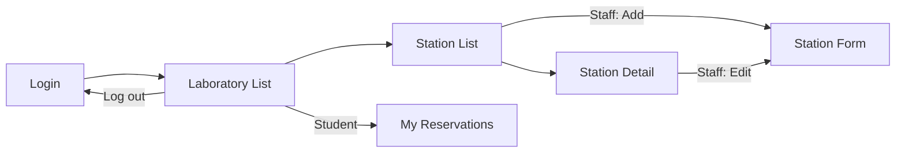

# INTPROG Final Project Proposal - Phase 1
Content for the official *Proposal Template* (sections 1-12). Paste into the .docx and add wireframes/diagrams.

| | |
|---|---|
| Student ID | 24258139 |
| Student Name / Section | *(fill in)* |
| Case Study No. | 21 |
| Case Study Title | Computer Laboratory Seat Monitor |
| Proposed Application Title | **Lab Seat Monitor** |

## 1. Case Analysis
**1.1 Background.** During open laboratory periods students walk into a computer lab without knowing which stations are free. Staff track stations from memory or a paper list.

**1.2 Primary problem.** There is no single, current record of each computer station's state (available / reserved / occupied / temporarily unavailable), so stations get double-assigned or students wait with no information.

**1.3 Stakeholders.** Students (need to find a usable station), laboratory staff (need accurate control of stations and faults).

**1.4 Limitations of current process.** State is not visible before arrival; reservations are informal and can clash; broken stations are not flagged; staff cannot easily see who is using what.

## 2. Proposed Mobile Solution
An Android app showing every laboratory and each station's *current state* in real time. A student checks a lab from anywhere, reserves a free station (one at a time), checks in on arrival, and releases it when done. Staff manage station states (mark broken/under maintenance, restore, cancel/release on behalf), and maintain the station list. A mobile app fits because the information is needed *before* walking to the lab and staff update it on the spot.

## 3. Roles
| Role | Description | Allowed actions |
|---|---|---|
| Student | Lab user | View labs/stations, reserve one station, check in, release, cancel own reservation, view own history |
| Laboratory Staff | Lab custodian | Everything a student can view; check in/cancel/release any station; mark unavailable (with reason) and restore; add/edit/delete stations |

## 4. Functional Requirements
| ID | Requirement | Role |
|---|---|---|
| FR-01 | The system shall let a user sign in and choose/identify their role (Student or Staff). | All |
| FR-02 | The system shall list all laboratories with the number of available stations. | All |
| FR-03 | The system shall list the stations of a laboratory with their current state. | All |
| FR-04 | The system shall filter stations by state (All/Available/Reserved/Occupied/Unavailable). | All |
| FR-05 | The system shall show a station's details (specs, state, holder, note, last update). | All |
| FR-06 | The system shall let a student reserve an available station. | Student |
| FR-07 | The system shall let a student (or staff for a reservation) check in, moving a station to Occupied. | Student, Staff |
| FR-08 | The system shall let the occupant or staff release a station, returning it to Available. | Student, Staff |
| FR-09 | The system shall let the reserving student or staff cancel a reservation. | Student, Staff |
| FR-10 | The system shall let staff mark an available station Unavailable with a reason and later restore it. | Staff |
| FR-11 | The system shall let staff add, edit and delete stations. | Staff |
| FR-12 | The system shall show a student their reservation/usage history. | Student |

## 5. Business Rules and Validation
| ID | Rule | Expected behaviour |
|---|---|---|
| BR-01 | Every station always has exactly one state: Available, Reserved, Occupied or Unavailable. | State is stored on the station and shown everywhere. |
| BR-02 | **Only an Available station can be reserved or freely assigned.** Reserved, Occupied and Unavailable stations are never assignable. | Action buttons for them are not offered; repository rejects the call anyway. |
| BR-03 | A Reserved station can only be checked in/cancelled by the reserving student or staff. | Other students see "Reserved by X". |
| BR-04 | A student may hold only one station (Reserved or Occupied) at a time. | Second reservation/check-in is refused with a message. |
| BR-05 | Only the occupant or staff may release an Occupied station. | Prevents others from freeing a seat in use. |
| BR-06 | Staff may mark a station Unavailable only from Available, and must give a reason (>= 3 chars). | Occupied/Reserved must be released/cancelled first. |
| BR-07 | Only staff can restore an Unavailable station. | Students cannot override a fault. |
| BR-08 | Station label is required, <= 10 chars and unique inside its laboratory. | Inline error on the form. |
| BR-09 | A Reserved or Occupied station cannot be deleted. | Delete refused with a message. |
| BR-10 | Login name is required (>= 2 characters). | Inline error. |

State transitions: `AVAILABLE -> RESERVED -> OCCUPIED -> AVAILABLE`, `AVAILABLE -> OCCUPIED` (walk-in), `RESERVED -> AVAILABLE` (cancel), `AVAILABLE <-> UNAVAILABLE` (staff only).

## 6. Screens
| # | Screen | Purpose | User |
|---|---|---|---|
| 1 | Login | Enter name, pick role (Firebase Auth in Phase 2) | All |
| 2 | Laboratory List | Labs + availability summary | All |
| 3 | Station List | Stations of a lab, status filter, staff "Add station" | All |
| 4 | Station Detail | State + permitted actions | All |
| 5 | Station Form | Add / edit station | Staff |
| 6 | My Reservations | Own reservation/usage history | Student |

## 7. Navigation / Screen Flow

Data passing: `labId` (List -> Stations), `stationId` (Stations -> Detail/Form).

## 8. Data Design
| Entity | Important fields | Purpose | Reference |
|---|---|---|---|
| AppUser | name, role | Signed-in user | users/{uid} |
| Lab | id, name, room | A laboratory room | - |
| Station | id, labId, label, specs, status, heldBy, note, updatedAt | One computer station and its current state | labId -> Lab |
| Reservation | id, stationId, stationLabel, labName, studentName, state, startedAt, endedAt | History of a reservation/use | stationId -> Station |

(Kotlin: `model/Models.kt`.)

## 9. Proposed Firebase Structure (Realtime Database)
```
users/{uid}          : { name, role }
labs/{labId}         : { name, room }
stations/{stationId} : { labId, label, specs, status, heldBy, note, updatedAt }
reservations/{resId} : { stationId, stationLabel, labName, studentName, state, startedAt, endedAt }
```
Phase 3 note: reserve/check-in must use a Firebase **transaction** on `stations/{id}` so two students cannot take the same station at the same moment.

## 10. Wireframes
Draw/screenshot screens 1-4 (screens of the running Phase 1 app may be used as reference).

## 11. Scope and Limitations
**In scope:** roles Student/Staff, lab + station monitoring, state workflow, one-station-per-student rule, station management, history.
**Out of scope:** hardware/OS-level detection of real logins, automatic reservation expiry/timers, push notifications, multi-campus/admin management, QR check-in.

## 12. Phase 1 Implementation Plan (status in this project)
| Item | Implementation | Status |
|---|---|---|
| Android project setup | Kotlin, ViewBinding, Material 3, minSdk 24 | Done - **verify build in LAB** |
| Major screens | 6 Activities | Done |
| Navigation | Intents between all screens | Done |
| Data passing | `EXTRA_LAB_ID`, `EXTRA_STATION_ID` | Done |
| Data class/model | `model/Models.kt` | Done |
| RecyclerView | `LabAdapter`, `StationAdapter` (grid), `ReservationAdapter` | Done |
| Mock data | `LabRepository.seed()` (3 labs, 26 stations) | Done |
